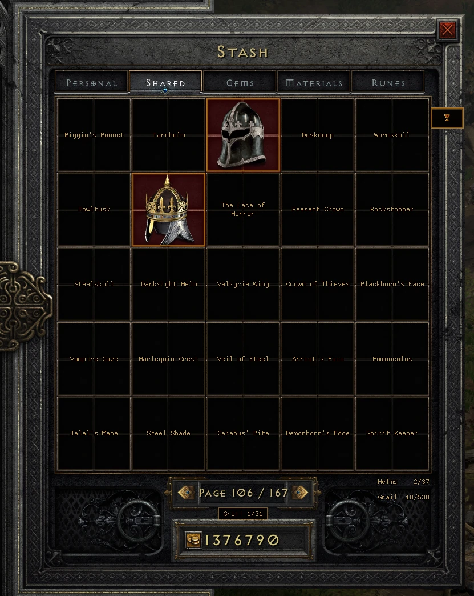
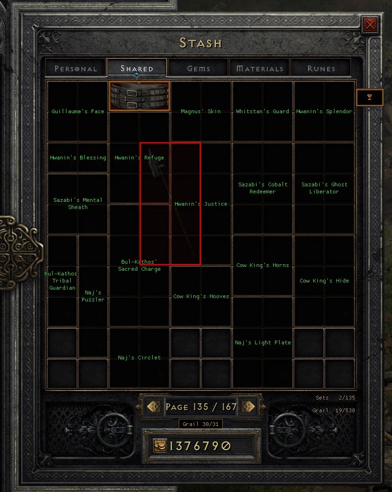
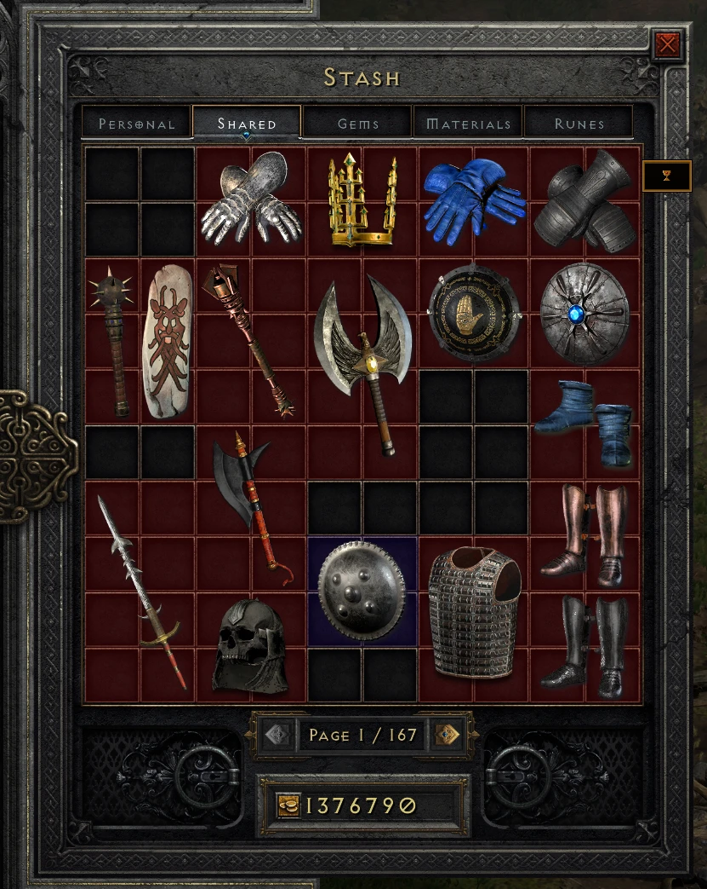

# Grail Tab

A [D2RLoader](https://d2rloader.net) plugin for Diablo II: Resurrected. It adds a block of
31 shared stash tabs with a home slot for every unique and set item: 538 slots, grouped by
item type, with every set kept together on one page.

- Empty slots show the missing item's name, gold for uniques and green for sets.
- Items in their home slot get a gold border, and items in the wrong slot get a red one.
- Ctrl+click a unique or set item in your inventory and it moves straight to its slot.
- A chalice button on the stash frame jumps to the grail, and back to page 1.
- Beside the page arrows: the section you're on, its count, and your whole grail
  (`Grail 18/538`).

<p align="center">
  
  
</p>

For offline single player. Remove the DLL before playing online.

## Requirements

- Diablo II: Resurrected with Reign of the Warlock, which has 5 shared stash tabs.
- D2RLoader 1.3.1 or newer, with D2RCore's extra stash tabs (`add_shared_tabs` under
  `[d2rcore.stash]` in `d2rloader/config/d2rloader.toml`).

## Install

1. Install D2RLoader ([download](https://d2rloader.net/download.html), [guide](https://d2rloader.net/docs.html)).
2. Download `grail-tab.dll` from [Releases](../../releases).
3. Put it in `<game folder>/d2rloader/plugins/` and start the game through D2RLoader.

## Setup (once)

1. Open your stash. A banner under the grid asks you to set up Grail Tab.
2. Click the chalice  on the
   right edge of the stash frame, beside the top row of the grid. Grail Tab copies
   `d2rloader.toml` to `d2rloader.toml.before-grail-tab.bak`, then raises
   `add_shared_tabs` by 31. Your existing tabs stay where they are; the grail tabs come
   after them.
3. Quit and relaunch the game. D2RCore only picks up the new tab count when the game starts.

<p align="center">
  
</p>

## Use

- **Chalice:** jumps to the first grail page; on a grail page, back to shared page 1. To
  use a key instead, bind one under **Options → Controls → Grail Tab**. It's unbound by
  default.
- **Ctrl+click** a unique or set item in your inventory while the stash is open and it
  moves to its slot. From a grail page, the stash turns to the item's page. While you hold
  Ctrl, the stash can only turn 10 pages per arrow click, so the page sometimes follows
  after you let go of Ctrl. Away from the grail pages, items you already have and items with
  no grail slot get the game's normal Ctrl+click; on a grail page they're refused with a
  message.
- You can also drag items in by hand. The borders show whether they landed in the right
  slot.

Grail Tab only works out which stash page is showing from what you do: arrow clicks,
hovering or clicking a stash item, or the chalice. If the labels don't appear right after
opening the stash, hover any item or click the chalice.

## Settings

`d2rloader/config/grail-tab.toml`, created on first launch:

| Setting | Default | What it does |
|---|---|---|
| `first_tab` | set by setup | The tab where the grail block starts. Don't change it after you've filed items. |
| `sets` | `true` | Include the 7 set pages after the 24 unique pages. |
| `ctrl_click` | `true` | Ctrl+click files items. |
| `ctrl_click_from` | `"shared"` | Where Ctrl+click files from: `"grail"` (grail pages only), `"shared"` (any Shared page) or `"stash"` (any stash tab). |
| `block_non_grail` | `true` | On a grail page, Ctrl+click on an item with no grail slot does nothing instead of the game's normal move. |
| `ghost_labels` | `true` | Names in empty slots. |
| `mark_misplaced` | `true` | Red border on items in the wrong slot. |
| `mark_filed` | `true` | Gold border on items in their home slot. |
| `button` | `true` | The chalice button. |

## Don't lower `add_shared_tabs`

The grail tabs are ordinary shared stash tabs at the end of your stash. If `add_shared_tabs`
drops below the grail block, those tabs disappear, along with the items in them. That can
happen if you move D2RCore's stash tab slider in Options, or restore
`d2rloader.toml.before-grail-tab.bak` after setup. Grail Tab shows a red warning on the
stash when that happens: raise `add_shared_tabs` back to the number it gives and relaunch.

## Troubleshooting

- **Nothing draws on the stash.** The loader's overlay clips everything on D2RLoader 1.3.1,
  and Grail Tab works around that by recognizing a few instructions in the game. After a
  game update they may not match. Check `d2rloader/logs/grail-tab.log` for
  `Overlay clip fix: off`; if it's there, Grail Tab needs an update for that game version.
- **The `grail-status` console command** shows setup, tab counts and what the plugin can see.
  It also writes them to `d2rloader/logs/grail-tab.log`, which is cleared each time the game
  starts: attach that file to a bug report before relaunching.
- **The `grail-debug` console command** logs clicks, page tracking and item moves to the
  console and the log.
- **Labels don't line up with the grid.** Ultrawide screens (wider than 19:9, such as
  3440x1440) are handled since 1.0.1. Screens narrower than 16:9 (16:10 like 1920x1200 or the
  Steam Deck, and 4:3) aren't yet. Run `grail-status` with the stash open and include its last
  line and a screenshot in a bug report: it shows the screen size and where Grail Tab draws the
  grid.
- **Mods that change the unique or set item tables.** Grail Tab's slots come from the unmodded
  tables. Items a mod adds at the end of those tables have no slot; a mod that inserts or
  reorders rows can make it label and file the wrong items. Support for modded tables is
  planned. To help, run `grail-tables` while in a game: it writes
  `d2rloader/logs/grail-tab-tables.txt` with the tables your game loaded and which built-in
  slots no longer match. Attach that file to an issue, with the name of your mod.

## How it works

- It reads the stash through the loader's item and inventory services.
- It moves the existing item with the loader's item transaction service. It never creates
  or edits items.
- It turns pages by sending the stash's own arrow messages.
- It draws with the loader's overlay.

The layout comes from the game's own item tables (`gen_layout.py`) and is frozen in
`layout_v1.tsv`, so future versions can't move a slot you've already filled.

## Build

Cross-compiles on Linux with clang-cl, lld and the MSVC CRT and Windows SDK from
[xwin](https://github.com/Jake-Shadle/xwin):

```sh
git submodule update --init
xwin --accept-license splat --output ~/.xwin
cmake -S . -B build -G Ninja -DCMAKE_TOOLCHAIN_FILE=$PWD/toolchain-xwin.cmake -DCMAKE_BUILD_TYPE=Release
ninja -C build
```

`grail_layout.h` is generated and checked in. To regenerate it, point `D2R_EXCEL` at the
game's extracted `data/global/excel` folder and run `python3 gen_layout.py`.

## Credits

The overlay clipping workaround follows the notes Pyre-Flies published with Floating Damage
([D2R-Mods](https://github.com/Pyre-Flies/D2R-Mods)).

## License

GPL-3.0. Built with the MIT-licensed [D2RLoader Plugin SDK](https://github.com/D2RLoader/PluginSDK).
